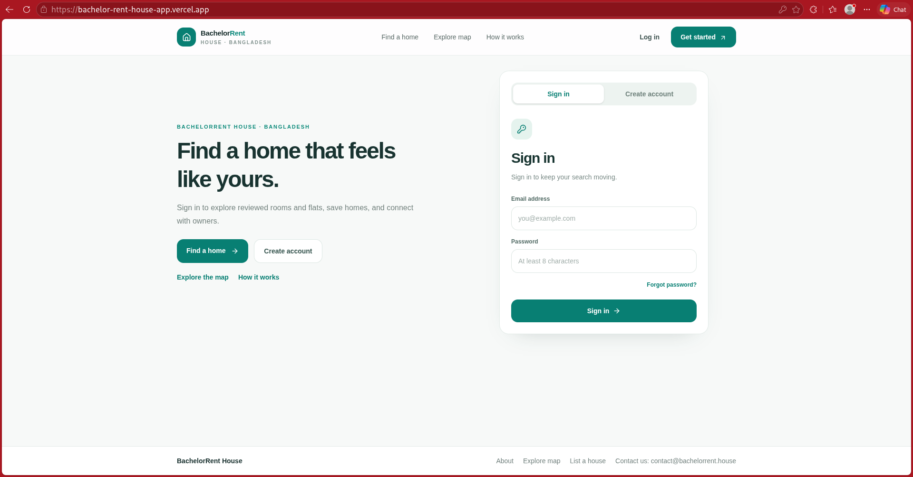
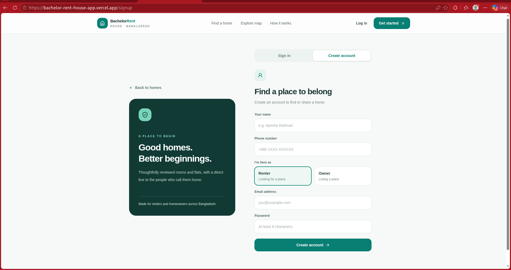
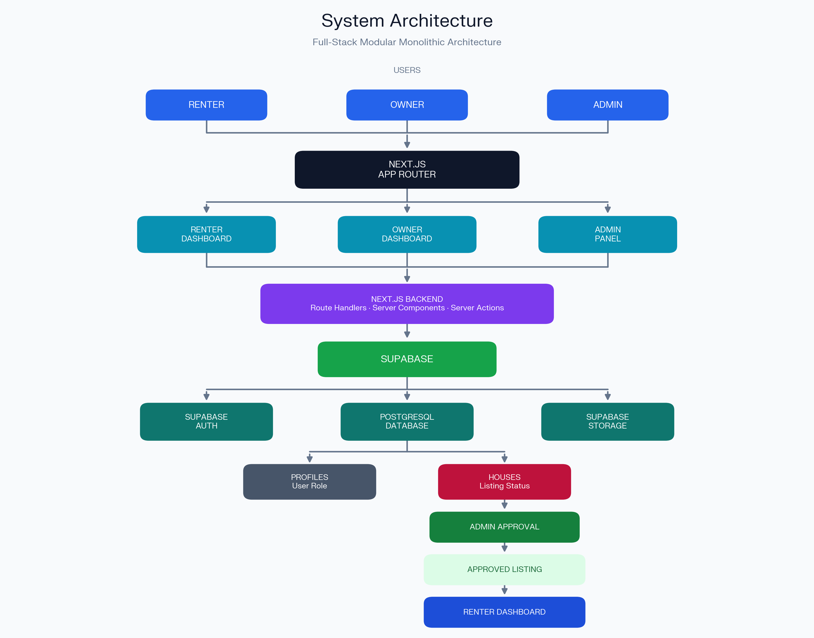
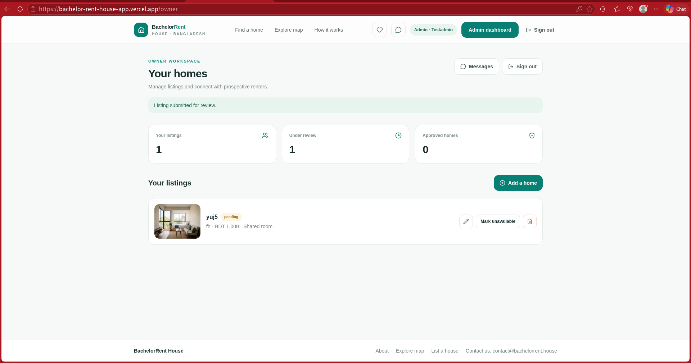
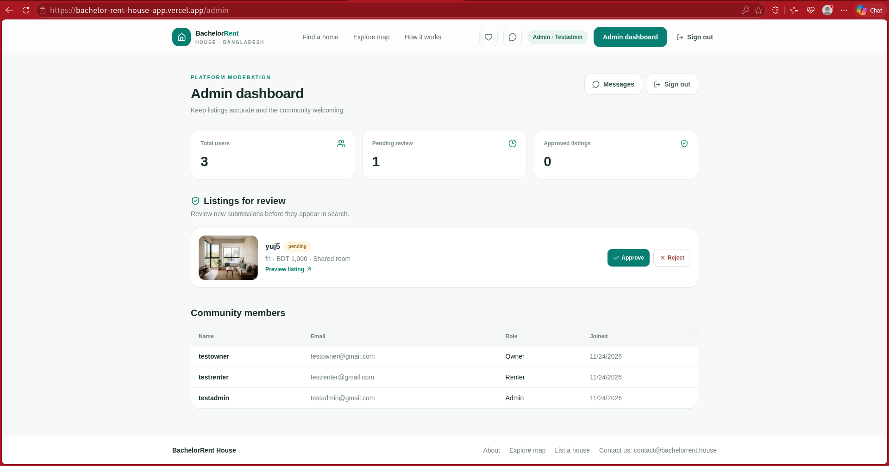
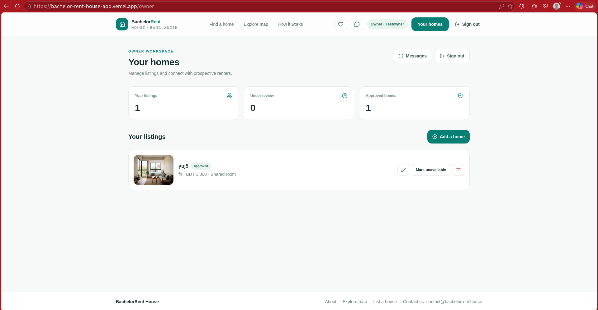
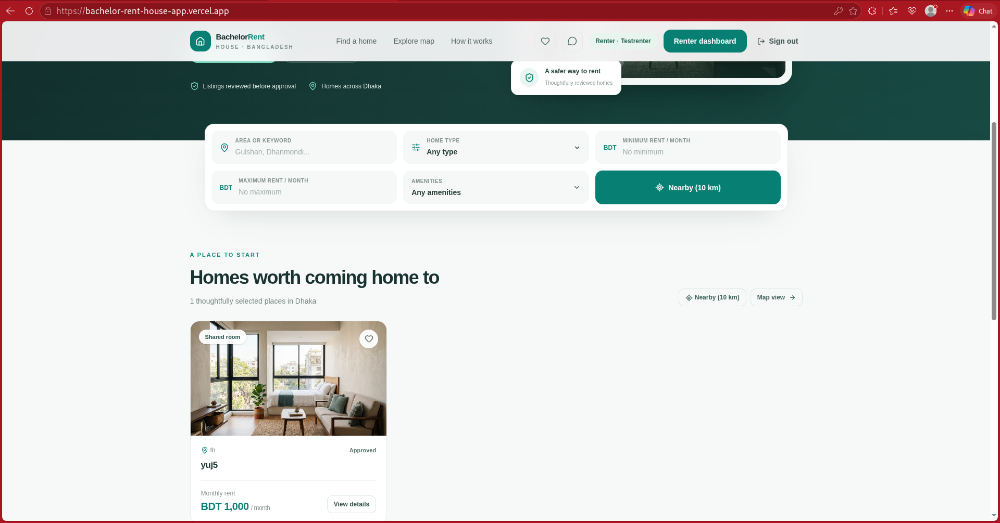
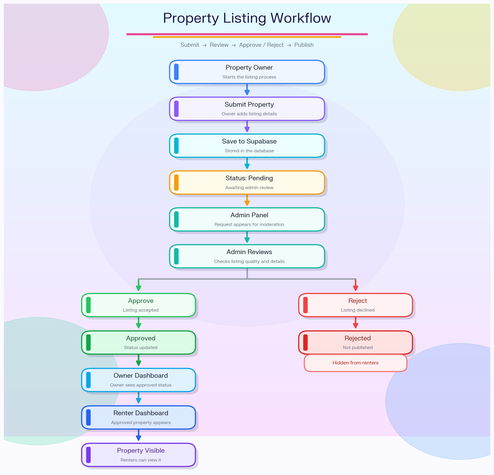

# Smart Bachelor Rental Housing

**A Trusted Web-Based Rental Platform for Bachelors in Bangladesh**

Smart Bachelor Rental Housing is a web-based platform designed to help students and working professionals in Bangladesh find suitable rental rooms, seats, and flats.

The platform connects property owners with renters through a role-based system. To ensure trust and reliability, every property listing submitted by an owner must be reviewed and approved by an administrator before becoming visible on the renter's dashboard.

---



## 1. Project Overview

The platform has three main user roles:

- **Renter:** Searches and views approved rental property listings.
- **Property Owner:** Submits rental property listings and tracks their approval status.
- **Admin:** Reviews submitted property listings and approves or rejects them.



### Core Concept

A property listing does not become publicly visible immediately after submission. Instead, it follows a controlled approval workflow:

**Owner Submission → Pending → Admin Review → Approved → Renter Dashboard**

This approval process helps prevent unverified or incomplete property listings from appearing to renters.

---
## 1.1 System Architecture

Smart Bachelor Rental Housing is built using a full-stack architecture powered by Next.js and Supabase. The system provides separate interfaces and role-based access for renters, property owners, and administrators.

Next.js handles the frontend and backend application logic, while Supabase provides authentication, PostgreSQL database services, and data security.

### System Architecture Diagram

<!-- Add your System Architecture Image Here -->




## 2. User Roles & Functionalities

### 2.1 Renter

Renters are students or working professionals looking for bachelor-friendly accommodation.

**Features:**

- Create a renter account.
- Sign in and sign out.
- Access the renter dashboard.
- Browse available rental property listings.
- View only admin-approved properties.
- Pending and rejected listings remain hidden from renters.

### 2.2 Property Owner

Property owners can submit rental property information through their dedicated dashboard.

**Features:**

- Register and sign in as a property owner.
- Access the owner dashboard through `/owner`.
- Submit new rental property listings.
- Newly submitted listings are automatically assigned `Pending` status.
- View submitted property listings.
- Track the approval status of each listing.
- See when a property listing has been approved by the admin.

### 2.3 Admin

The administrator manages property listing moderation and approval.

**Features:**

- Access the admin panel using an account with the `admin` role.
- View property listing requests submitted by owners.
- Review pending property information.
- Accept / Approve submitted property requests.
- Reject inappropriate or incomplete listings.
- Update property listing status.
- Ensure only approved listings are visible to renters.

---

## 3. Property Submission & Admin Approval Workflow

This is the core workflow of the Smart Bachelor Rental Housing platform.

The system follows a five-step process to ensure that every property listing is reviewed before being displayed to renters.

)

### Step 01: Owner Submits a Property Listing

The property owner logs in to the owner dashboard and submits a new rental property listing.

After submission:

- The property information is saved in the Supabase database.
- The listing status is automatically set to `Pending`.
- The property is not immediately visible to renters.

**Screenshot – Owner Submits Property**

<!-- Add your owner submission screenshot here -->



### Step 02: Pending Request Appears in Admin Panel

After the owner submits the property, the request automatically appears in the admin panel.

The administrator can:

- View pending property requests.
- Check the submitted property information.
- Review the listing before making a decision.

At this stage, the listing remains in `Pending` status.

**Screenshot – Admin Panel Showing Pending Requests**

<!-- Add your admin pending requests screenshot here -->



### Step 03: Admin Accepts the Property Request

After reviewing the property information, the administrator clicks the **Accept / Approve** button.

Once the request is accepted:

- The listing status changes from `Pending` to `Approved`.
- The updated status is saved in the Supabase database.
- The approved property becomes eligible to appear on the renter dashboard.

**Screenshot – Admin Approves Property**

<!-- Add your admin approval screenshot here -->



### Step 04: Owner Sees Approved Status

After the admin approves the request, the property owner can return to their dashboard and see that the submitted property has been successfully approved.

The listing status is displayed as `Approved` instead of `Pending`.

**Screenshot – Owner Dashboard Showing Approved Status**

<!-- Add your owner approved status screenshot here -->


### Step 05: Approved Property Appears on Renter Dashboard

Once the listing is approved, it becomes visible in the renter dashboard.

Renters can now browse and view the approved property listing.

Pending or rejected properties are not displayed to renters.

**Screenshot – Renter Dashboard Showing Approved Property**

<!-- Add your renter dashboard screenshot here -->



---

## 4. Property Listing Status

Each property listing follows a status-based approval system.

| Status | Description |
|---|---|
| `Pending` | Property submitted by the owner and waiting for admin review. |
| `Approved` | Property reviewed and accepted by the admin. |
| `Rejected` | Property rejected by the admin and hidden from renters. |

---

## 5. Complete Property Approval Flow



---


---

## 6. Main Features

### Authentication & Account Management

- User registration and sign-in.
- Renter and owner role selection during registration.
- Forgot password and password recovery.
- Secure sign-out functionality.
- Supabase Authentication integration.

### Role-Based Routing

- Role-based dashboard redirection.
- Renter dashboard for renters.
- Owner dashboard at `/owner`.
- Admin panel for administrators.
- Protected routes based on user roles.

### Property Listing Management

- Property owners can submit rental listings.
- New listings are automatically saved as `Pending`.
- Admins can approve or reject submitted listings.
- Owners can track their listing status.
- Approved listings become visible to renters.

### Admin Approval System

- Admin panel displays pending property requests.
- Admin can review submitted property details.
- Accept / Approve and Reject actions.
- Listing status updates in Supabase.
- Approved listings appear on the renter dashboard.

### Database Security

- User roles are managed through the `profiles` table.
- Property listings are managed through the `houses` table.
- Supabase Row Level Security (RLS) controls database access.
- Listing approval status controls renter visibility.

---

## 7. System Architecture

**Architecture Pattern:** Full-Stack Modular Monolithic Architecture

```text
                  USERS
                    |
       +------------+------------+
       |            |            |
     RENTER        OWNER        ADMIN
       |            |            |
       +------------+------------+
                    |
               NEXT.JS
              APP ROUTER
                    |
       +------------+------------+
       |            |            |
     RENTER        OWNER        ADMIN
    DASHBOARD    DASHBOARD     PANEL
       |            |            |
       +------------+------------+
                    |
          NEXT.JS BACKEND
        (Route Handlers / Server
         Components / Server Actions)
                    |
                SUPABASE
                    |
       +------------+------------+
       |            |            |
   SUPABASE       POSTGRESQL   SUPABASE
     AUTH         DATABASE     STORAGE
                    |
             +------+------+
             |             |
          PROFILES       HOUSES
             |             |
          USER ROLE    LISTING STATUS
                           |
                    ADMIN APPROVAL
                           |
                    APPROVED LISTING
                           |
                    RENTER DASHBOARD
```

---

## 8. Technology Stack

| Component            | Technology                        |
| -------------------- | --------------------------------- |
| Frontend             | Next.js                           |
| Framework            | Next.js App Router                |
| Backend              | Next.js                           |
| Programming Language | TypeScript                        |
| Authentication       | Supabase Auth                     |
| Database             | Supabase PostgreSQL               |
| Database Security    | Supabase Row Level Security (RLS) |
| Hosting & Deployment | Vercel                            |
| Version Control      | Git & GitHub                      |

---

## 9. Database Structure

The current system uses two main database tables.

### `profiles`

Stores user profile information and assigned roles.

| Field  | Description                            |
| ------ | -------------------------------------- |
| `id`   | User ID associated with authentication |
| `role` | User role: `renter`, `owner`, or `admin` |

### `houses`

Stores rental property listing information and approval status.

| Field               | Description                             |
| ------------------- | --------------------------------------- |
| Property ID         | Unique listing identifier               |
| Owner ID            | ID of the property owner                |
| Listing Information | Rental property details                 |
| Status              | `Pending`, `Approved`, or `Rejected`    |

*Note: Update the field names in this section if your actual Supabase database schema uses different names.*

---

## 10. Role-Based Access Control

The application uses the user's assigned role to determine dashboard access.

| User Role | Access                               |
| --------- | ------------------------------------ |
| `renter`  | Renter Dashboard / Approved Listings |
| `owner`   | Owner Dashboard (`/owner`)           |
| `admin`   | Admin Approval Panel                 |

Supabase Row Level Security (RLS) is used to enforce database-level access restrictions according to the configured policies.

---

## 11. Deployment

The application is designed to be deployed using Vercel.

- **Application Hosting:** Vercel
- **Authentication:** Supabase Auth
- **Database:** Supabase PostgreSQL
- **Source Code Management:** GitHub

---

## 12. Project Goal

The long-term goal of Smart Bachelor Rental Housing is to build a trusted bachelor rental marketplace across Bangladesh.

The platform aims to:

- Simplify accommodation searching for students and working professionals.
- Connect renters with property owners.
- Improve trust through administrator-reviewed property listings.
- Provide a structured and role-based rental management system.
- Expand the platform to different cities across Bangladesh.

---

## 13. Project Status

| Item                      | Details                                                                 |
| ------------------------- | ----------------------------------------------------------------------- |
| Project Name              | Smart Bachelor Rental Housing                                           |
| Platform                  | Web Application                                                         |
| Architecture              | Full-Stack Next.js                                                      |
| Database & Authentication | Supabase                                                                |
| Deployment Platform       | Vercel                                                                  |
| Current Focus             | Authentication, Role-Based Access, Property Submission & Admin Approval |
